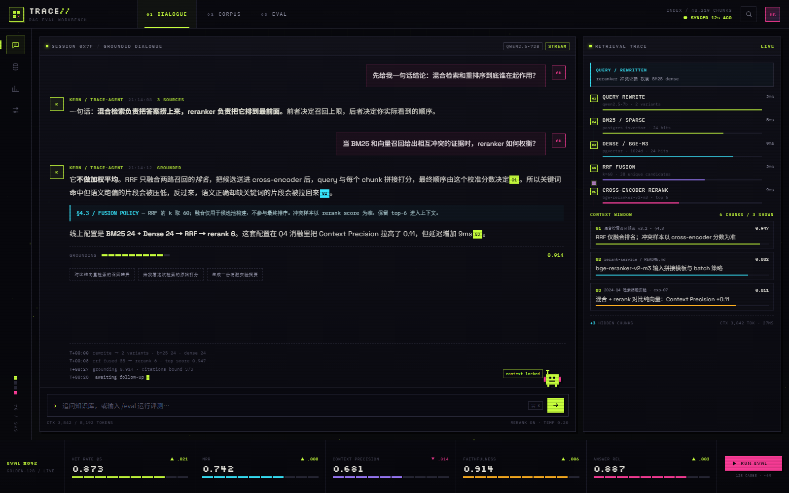

# TRACE // — RAG Eval Workbench

一个带评估系统的 RAG 知识对话平台：**知识入库 → 混合检索 → 重排序 → 有引用回答 → 指标评测**。
前端采用已选定的 **A · KERNEL ARCADE** 视觉方向（8-bit 霓虹实验室），后端以 FastAPI + PostgreSQL 为核心。



## 当前状态

| 里程碑 | 内容 | 状态 |
|---|---|---|
| M0 | 仓库骨架、架构 / API 文档、LLMDOC、设计定稿 | ✅ 已提交（main） |
| M1 | FastAPI 骨架、数据库模型、迁移、健康检查 | 🚧 进行中（API shell 已提交） |
| M2 | 文档入库、切分、向量化、BM25 + pgvector 混合检索、重排 | ⏳ |
| M3 | 对话 API、引用、检索 trace、前端联调 | ⏳ |
| M4 | 评测集、评测执行器、Hit/MRR/CP + HF Faithfulness/Relevance | ⏳ |
| M5 | 前端三视图（对话 / 知识库 / 评测）与动效打磨 | ⏳ |

> M0 已提交并推送；M1-1 的 FastAPI shell（配置、错误信封、健康检查）已提交，数据库模型与迁移在 M1-2。

## 技术栈

- **Web**：React 19 · Vite · TypeScript · Zustand · Tailwind CSS · shadcn/ui · axios
- **API**：FastAPI · Pydantic v2 · SQLAlchemy 2 (async) · Alembic
- **DB**：PostgreSQL 16 + pgvector
- **检索**：pgvector 稠密召回 + rank-bm25（jieba）稀疏召回 + RRF 融合 + bge-reranker-v2-m3
- **模型**：BGE-M3（本地）/ DeepSeek（OpenAI 兼容）/ 多语 NLI + 多语 embedding（HF 本地或 Inference API）

## 目录

```text
.
├─ apps/
│  ├─ api/                  # FastAPI 应用（M1 起）
│  └─ web/                  # React 应用（M1 起）
├─ docs/
│  ├─ ARCHITECTURE.md       # 架构、数据流、决策记录
│  └─ API.md                # 手写 API 契约（与 OpenAPI 同步）
├─ design/                  # 四版设计原型，A 为选定方向
├─ LLMDOC.md                # 给 reviewer / subagent 的项目压缩上下文
├─ docker-compose.yml       # 仅 PostgreSQL + pgvector
├─ .env.example
└─ README.md
```

## 本地启动（M0 仅数据库可启动）

```bash
# 终端 1：数据库（独立容器，端口 5433，不碰其他项目）
docker compose up -d db

# 终端 2：配置 + 依赖（仓库根目录）
cp .env.example .env        # Windows: Copy-Item .env.example .env
# 填入 LLM_API_KEY / HF_TOKEN
python -m venv .venv
.venv\Scripts\activate      # macOS/Linux: source .venv/bin/activate
pip install -e "apps/api[ml]"   # M1 后可用

# 终端 3：迁移 + API（迁移内含 CREATE EXTENSION vector）
cd apps/api
alembic upgrade head
uvicorn app.main:app --reload --port 8000

# 终端 4：前端
cd apps/web
pnpm install
pnpm dev
```

种子数据在仓库根目录执行 `python scripts/seed.py`；它需要数据库已迁移。

- Web：<http://localhost:5173>
- API：<http://localhost:8000>
- OpenAPI：<http://localhost:8000/docs>

## 文档

- [架构与决策](docs/ARCHITECTURE.md)
- [API 契约](docs/API.md)
- [LLMDOC（项目压缩上下文）](LLMDOC.md)
- [设计说明](design/DESIGN-NOTES.md)

## 约定

- 代码注释使用中文，解释“为什么”，不复述代码。
- 模块解耦：路由只做参数校验与编排；检索、生成、评测各自 service 独立可测。
- 每个提交前由独立只读 subagent 审核；超过 5 轮未收敛则回到方案讨论。
- 每次提交同步更新 `README.md`、`docs/API.md`、`LLMDOC.md`。

## 设计来源

四版概念原型见 `design/`：A KERNEL ARCADE（选定）、B GROUNDTRUTH、C SIGNAL GARDEN、D CHROMA//DECK。
对比页：`design/index.html`。
