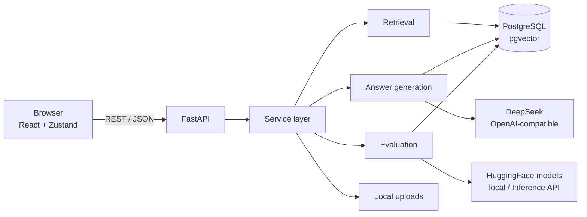
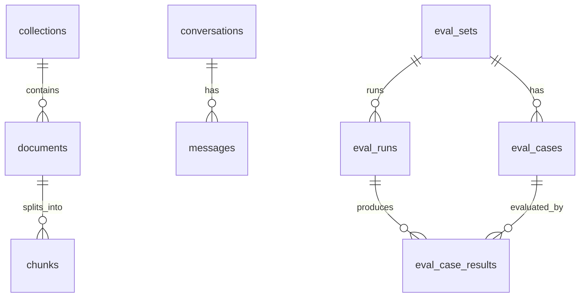
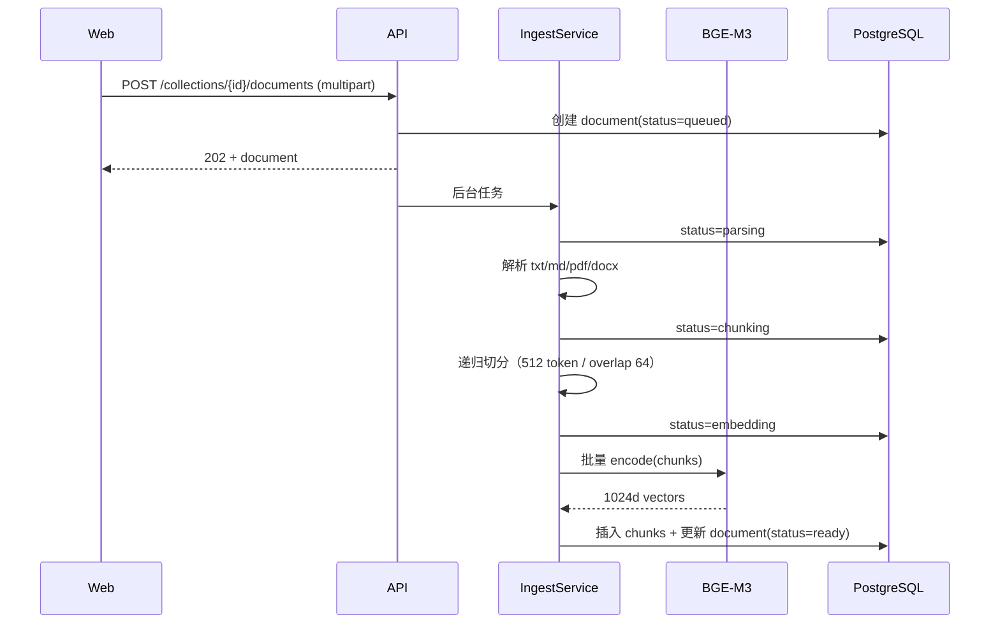
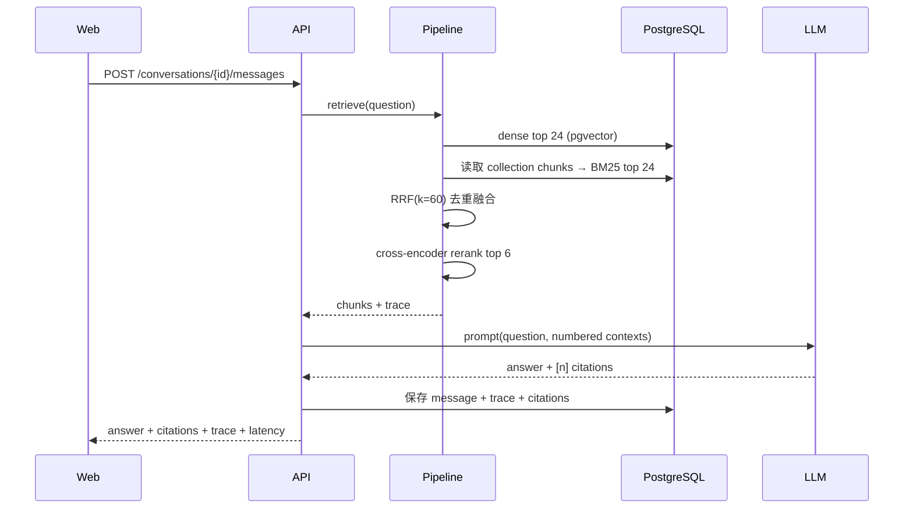

# 架构设计

> 版本：M0（框架设计）
> 最后更新：2026-11-26
> 代码尚未开始；本文是 M1–M5 的实现契约。

## 1. 目标与非目标

### 目标

1. 一条可演示、可复现的 RAG 链路：上传 → 切分 → 向量化 → 混合检索 → 重排序 → 带引用回答。
2. 一套能解释“为什么这个回答可信 / 不可信”的评估系统：Hit Rate@K、MRR、Context Precision、Faithfulness、Answer Relevance。
3. 前端保持 A · KERNEL ARCADE 的视觉识别度，同时保证中文长文可读、数据可扫读。
4. 模块边界清晰：检索、生成、评测、存储各自可替换、可单测。

### 非目标（MVP）

- 登录、多租户、RBAC；这是单用户个人工作台。
- 分布式任务队列 / 多副本部署；评测用进程内后台任务，重启会丢运行中的 run（文档标注）。
- 流式 token 输出；MVP 用一次性响应 + 前端 thinking 态，后续可加 SSE。
- 对象存储；上传文件落本地 `apps/api/data/uploads/`，路径写入 DB。
- 多语言 UI；界面中文 + 英文技术标签。

## 2. 系统总览



**依赖方向**：`api/routes → services → db/models / core`。
路由不直接写 SQL；service 不依赖 FastAPI 的 `Request`；模型层不依赖 service。

## 3. 仓库边界

```text
apps/api/app/
  main.py                # create_app / lifespan / CORS / router 装配
  core/                  # config, logging, errors, security
  db/                    # engine, session, base, models
  api/routes/            # health, stats, collections, documents, conversations, eval
  schemas/               # Pydantic request/response
  services/
    ingest.py            # 解析、切分、向量化、入库
    retrieval/           # dense, sparse, fusion, rerank, pipeline
    answer/              # prompts, deepseek client, extractive fallback
    evaluation/          # metrics, judges, runner
    storage.py           # 本地文件读写（后续可替换 S3）
  workers/               # 进程内后台任务注册与生命周期
apps/web/src/
  app/                   # router, layout, providers
  components/ui/         # shadcn 组件（源码进仓库）
  components/brand/      # PixelMascot, CodeRain, Scanlines
  features/chat/         # Thread, Composer, RetrievalTrace, Citation
  features/corpus/       # CollectionGrid, DocumentTable, IngestDialog
  features/eval/         # MetricDeck, RunChart, CaseTable, RunDialog
  stores/                # app, chat, corpus, eval
  lib/                   # api.ts, format.ts, cn.ts
  styles/                # tokens.css, globals.css
```

## 4. 数据模型

主键统一 `uuid`（`gen_random_uuid()`），时间统一 `timestamptz`（UTC 存储，前端本地化）。



| 表 | 关键字段 | 说明 |
|---|---|---|
| `collections` | `name`, `description`, `document_count`, `chunk_count`, `index_version` | 知识库；计数为冗余字段，入库/删除后刷新；`index_version` 每次变更 +1，用于 BM25 缓存失效 |
| `documents` | `collection_id`, `title`, `filename`, `mime`, `status`, `error`, `chunk_count`, `size_bytes`, `meta` | `status ∈ queued/parsing/chunking/embedding/ready/failed` |
| `chunks` | `document_id`, `collection_id`, `content`, `search_text`, `chunk_index`, `heading_path`, `token_count`, `embedding vector(1024)`, `meta` | `search_text` 是 jieba 分词后的文本；`embedding` 上建 HNSW cosine 索引 |
| `conversations` | `title`, `created_at`, `updated_at` | 会话标题取首条提问前 30 字 |
| `messages` | `conversation_id`, `role`, `content`, `citations`, `trace`, `model`, `latency_ms`, `token_usage` | `role ∈ user/assistant` |
| `eval_sets` | `name`, `description`, `case_count` | 评测集 |
| `eval_cases` | `set_id`, `question`, `ground_truth`, `relevant_chunk_ids uuid[]`, `meta` | 相关 chunk 是 Hit/MRR/CP 的唯一依据 |
| `eval_runs` | `set_id`, `status`, `config`, `metrics`, `error`, `started_at`, `finished_at` | `status ∈ queued/running/succeeded/failed/cancelled` |
| `eval_case_results` | `run_id`, `case_id`, `answer`, `retrieved_ids`, `metrics`, `status`, `latency_ms`, `trace`, `error` | `status ∈ pass/warn/fail/error`；API 把 `retrieved_ids` 展开为 `retrieved`（含 rank/score） |
| `judge_cache` | `key`, `kind`, `model`, `score`, `raw` | key = sha256(question/answer/context/model/kind)，避免重复付费 |

索引：

- `chunks(collection_id)`、`chunks(document_id)`；
- `chunks USING hnsw (embedding vector_cosine_ops)`；
- `chunks USING gin (to_tsvector('simple', search_text))` 作为备用 FTS；
- `messages(conversation_id, created_at)`；
- `eval_case_results(run_id, status)`。

## 5. 入库链路



切分规则：

- 约 512 token，重叠 64；按段落/标题优先，超长段落再按句号切。
- `heading_path` 保留 `H1 > H2 > H3`，用于引用展示与定位。
- 过滤空块、纯页码、重复页眉；原文高亮以 `chunk.content` 在文档解析结果中的匹配为准，M0 不存 offsets。
- 单文件上限 20MB；允许 `.txt .md .pdf .docx`。

失败处理：任一步失败写 `error`，状态 `failed`；允许重新上传，不自动重试。

## 6. 问答链路



### 6.1 稠密召回

```sql
SELECT id, 1 - (embedding <=> :qvec) AS score
FROM chunks
WHERE collection_id = ANY(:cids)   -- 单库或跨库；省略 collection_ids 时传全部 id
ORDER BY embedding <=> :qvec
LIMIT :k;
```

### 6.2 稀疏召回

- 使用 `rank_bm25.BM25Okapi`，语料是每个 collection 的 `search_text`（jieba 分词）。
- 进程内 LRU 缓存，key = `collection_id + index_version`；任何入库/删除都把该 collection 的 `index_version` +1，避免删除旧文档后 `max(updated_at)` 不变导致脏索引。
- 查询同样 jieba 分词；跨 collection 时每库各取 top 24，合并后按 BM25 分数降序取全局 top 24，再进入 RRF。
- 优点：真正 BM25，中文分词可控；缺点：单机内存索引。规模上去后替换 OpenSearch / pg_bm25，接口不变。

### 6.3 融合

Reciprocal Rank Fusion：

```
score(d) = Σ_i 1 / (k + rank_i(d))     k = 60
```

按 chunk id 去重；保留每路原始 rank/score 写入 trace。

### 6.4 重排

- `BAAI/bge-reranker-v2-m3` CrossEncoder，batch 8，`max_length=512`。
- 输入 `(question, chunk.content)`；取 sigmoid 分数，top 6。
- 模型不可用时退化为 RRF 分数排序，trace 标记 `rerank=fallback`。

### 6.5 生成

Prompt 约束：

1. 只使用编号上下文；不足则回答“现有资料不足”。
2. 每个事实句末尾加 `[n]`；n 对应上下文编号。
3. 中文回答，先给结论，再给依据。
4. 不编造 API、数字、版本号。

无 `LLM_API_KEY` 时使用 `ExtractiveAnswerer`：抽取最高分 chunk 的 2–3 句 + 引用，UI 标注 `EXTRACTIVE`。它保证链路可跑，但不用于正式评测结论。

## 7. 评估系统

### 7.1 指标口径

| 指标 | 公式 | 实现 |
|---|---|---|
| Hit Rate@K | `1[∃ relevant ∈ topK]` 的均值 | 纯代码 |
| MRR@K | `mean(1 / rank_first_relevant)`，未命中记 0 | 纯代码 |
| Context Precision@K | `Σ(precision@i × rel_i) / |relevant|` | 纯代码 |
| Faithfulness | 答案拆 claim，逐条 NLI 判断能否被 context 蕴含；`supported / total` | HF NLI |
| Answer Relevance | `clip(cos(emb(question), emb(answer)), 0, 1)` | HF embedding |
| Composite | `0.45 × retrieval + 0.55 × generation` | 可配置 |

`retrieval = 0.4×Hit + 0.35×MRR + 0.25×CP`；`generation = 0.5×Faithfulness + 0.5×Relevance`。
**评测口径固定 K=5**（Hit@5 / MRR@5 / CP@5）；对话接口的 `top_k`（默认 6）只决定送入答案的上下文条数，不改变评测指标。
阈值：`pass ≥ 0.70`，`warn ≥ 0.50`，否则 `fail`（对单用例 composite）。

### 7.2 Judge 设计

```text
JUDGE_BACKEND=local | hf_api
JUDGE_NLI_MODEL=MoritzLaurer/mDeBERTa-v3-base-mnli-xnli
JUDGE_RELEVANCE_MODEL=sentence-transformers/paraphrase-multilingual-MiniLM-L12-v2
```

- **local**：`transformers` pipeline / `sentence-transformers`，模型懒加载，GPU 可用；HF cache 指向 D 盘。
- **hf_api**：`httpx` 调 HuggingFace Inference API，带 `HF_TOKEN`；失败重试 1 次后降级 local。local 也失败才记 `null` + `status=error`。
- Claim 拆分：中文按 `。！？；`，英文按 `.?!;`，过滤 < 6 字的碎片；最多 12 条，避免长答案拖慢。
- NLI 输入 `(context, claim)`，取 `entailment` 概率；> 0.5 视为支持。
- Faithfulness 无 claim（空答案）记 0，并在 `metrics.note="no_claims"` 说明；judge 调用失败则两者都为 `null`、`status=error`，不伪造成 0。
- 结果写 `judge_cache`，key 含模型版本；换模型即失效。

### 7.3 Runner

- `POST /eval/runs` 创建 `queued`，`asyncio.create_task` 启动；返回 202。已有 `queued|running` run 时返回 409 `RUN_IN_PROGRESS`，不做隐式排队。
- 并发度默认 1（GPU/模型共享），可配置 1–3。
- 取消：置 `cancel_requested`，当前用例跑完后停止；已完成结果保留，未跑用例不创建，最终 `cancelled`。
- 每个用例：检索 → 生成 → 代码指标 → judge → 写结果；单用例失败不终止整个 run，写 `error` 并继续。
- 运行结束汇总均值，更新 `eval_runs.metrics/status/finished_at`。
- 进程重启：启动时把 `running` 标记为 `failed`，error=`server restarted`。
- 前端每 2s 轮询 `GET /eval/runs/{id}`，完成后停。

### 7.4 评测集

- 种子数据：`scripts/seed.py` 创建 3 个 collection、约 12 篇文档、15 条评测用例。
- 每条用例必须人工确认 `relevant_chunk_ids`；不自动生成 ground truth。
- 后续支持导入 JSONL；本轮不做 UI 编辑。

## 8. 模型运行时

| 模型 | 用途 | 设备 | 备注 |
|---|---|---|---|
| `BAAI/bge-m3` | 文档/查询 embedding，1024d | CUDA/CPU | 已缓存；懒加载 |
| `BAAI/bge-reranker-v2-m3` | 重排 | CUDA/CPU | 已缓存；懒加载 |
| `MoritzLaurer/mDeBERTa-v3-base-mnli-xnli` | Faithfulness | CUDA/CPU | 首次下载 |
| `sentence-transformers/paraphrase-multilingual-MiniLM-L12-v2` | Answer Relevance | CUDA/CPU | 首次下载 |
| DeepSeek `deepseek-chat` | 生成 | 远端 | OpenAI 兼容 |

- `HF_HOME=D:\hf-cache`（用户要求不落 C 盘）；模型单例，`lifespan` 中只初始化轻量对象，首次调用再加载权重。
- 启动时 `/health` 返回 `models: {embedding: "lazy", reranker: "lazy", judges: "lazy"}`。
- 显存不足时按 `EMBEDDING_DEVICE` / `RERANKER_DEVICE` 分别降级 CPU；不要自动卸载，MVP 单用户。

## 9. 前端架构

### 路由

```text
/                → redirect /chat
/chat            → 对话 + 检索 trace + 底部指标
/corpus          → 知识库、文档、入库
/eval            → 评测概览、run 列表、指标
/eval/runs/:id   → run 详情、用例表
```

### 状态

| store | 内容 | 服务端来源 |
|---|---|---|
| `appStore` | 当前视图、侧栏折叠、全局 toast | 本地 |
| `chatStore` | 会话、消息、当前 trace、发送状态 | `/conversations` |
| `corpusStore` | collections、documents、上传队列、轮询 | `/collections` |
| `evalStore` | sets、runs、当前 run、轮询、过滤 | `/eval` |

原则：store 只存 UI 需要的派生状态；请求集中在 `lib/api.ts`；组件不直接 `axios`。
轮询使用 `setTimeout` 链并在卸载/切换时清理；错误统一 `toast`。

### 视觉

- 复用 `design/concept-a.html` 的 tokens 与布局：topbar 64px、rail 64px、聊天 + trace 双栏、底部 108px 指标带。
- 字体：Silkscreen（标题/数字）、Space Grotesk（西文正文）、IBM Plex Mono（标签/数据）、Noto Sans SC（中文正文）。
- 背景：canvas 代码雨 + 像素星 + CRT 扫描线；`prefers-reduced-motion` 时降为静态网格。
- shadcn 组件全部用 CSS variables 改写，禁止默认灰蓝色。
- 响应式：<1180px trace 收到聊天下方；<860px rail 变底部 tab，指标带横向滚动。

## 10. 关键决策记录

| # | 决策 | 理由 | 代价 |
|---|---|---|---|
| D1 | 选 A · KERNEL ARCADE | 用户选定；第一眼辨识度最高 | 长文阅读需克制像素字 |
| D2 | 单仓库、前后端分 apps | 个人项目，部署简单 | 无法独立扩缩容 |
| D3 | pgvector 而非独立向量库 | 少一个组件，事务一致 | 超大规模需迁 Milvus/Qdrant |
| D4 | BM25 进程内 | 中文分词可控、零扩展 | 单机内存；后续替换 |
| D5 | 进程内后台任务 | MVP 简单 | 重启丢 run；后续 Celery/Arq |
| D6 | 本地 HF 模型 | 稳定、不耗 API 额度、GPU 可用 | 首次加载慢、占显存 |
| D7 | DeepSeek 兼容 OpenAI | 已有 key；接口通用 | 供应商锁定弱 |
| D8 | 不做登录 | 个人平台，减少范围 | 不可公网多用户部署 |

## 11. 失败模式与降级

| 失败 | 行为 |
|---|---|
| embedding 模型加载失败 | 启动不崩；上传/查询返回 503 `MODEL_UNAVAILABLE`；健康检查标红 |
| reranker 失败 | 用 RRF 排序，trace 标记 fallback |
| LLM 超时/无 key | 抽取式回答，`model="extractive"` |
| HF judge 失败 | 该用例 `faithfulness/relevance/composite=null`、`status=error`，不参与 run 均值；run 的 `metrics.judge_failures` 记录数量 |
| 数据库断连 | 请求 503；健康检查失败 |
| 上传超限/类型不支持 | 413 / 415；422 仅用于 Pydantic 参数校验；错误信息含允许类型与大小 |

## 12. 环境与部署

- 开发：`docker compose up -d db`，API `uvicorn --reload`，Web `vite`。
- DB 端口 **5433**，独立 volume，不碰本机其他 PostgreSQL 容器。
- 第三方密钥（DeepSeek/HF）只放 `.env`（gitignore）；compose 内的开发库口令仅本地使用；前端不接触任何密钥。
- 迁移第一步必须 `CREATE EXTENSION IF NOT EXISTS vector;`，再建 `vector(1024)` 列与 HNSW 索引。
- 生产后续：API 容器 + Web 静态托管 + 外部 Postgres；评测任务迁队列；加鉴权与限流。
